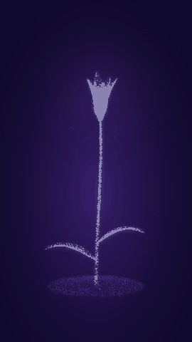
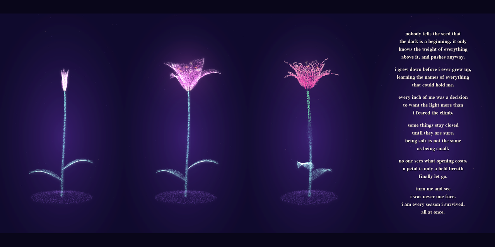

<div align="center">

# Poetry Lily

**A lily that grows from light, blooms, and turns into the poem it was holding all along.**




*the bloom, then the particles settling into verse*



</div>

---

## What it does

A 3D lily is built from about 26,000 glowing particles. It grows through five stages, then rewrites itself as text.

1. **Growth:** a stem rises from a mound of soil, with a bright gold tip, and two leaves unfurl.
2. **Bud and bloom:** a bud forms, then six curled petals open, shading from pink to cream, with stamens at the center.
3. **Rotation:** the whole flower turns in true 3D, so petals overlap and curve as the view changes.
4. **Particles become poetry:** the particles drift and settle into thousands of tiny letters that follow the curve of every petal, leaf and stem.
5. **Reading:** one part at a time, the letters burst into readable horizontal lines while that part of the plant fades. At the end, only the poem is left.

## How it works

- Every petal is a parametric surface, so it can open smoothly and be sampled for particles at any moment.
- Particles are projected from 3D to 2D with NumPy and accumulated into one image per frame, then given a soft bloom glow.
- Each particle is assigned to its nearest letter in the final layout, which is where it travels when the plant turns into text.
- The letters are placed along 3D curves, so they follow the surface of the flower and keep facing the viewer as it turns.

## Run it

You need Python 3 and two packages:

```
pip install pygame-ce numpy
python lily.py
```

Press `Esc` to close the window. The text stage draws thousands of letters, so it may run a little slower on older laptops.

## Make it yours

The poem lives in plain variables near the top of `lily.py`, one for each part of the plant (`soil_text`, `root_text`, `stem_text`, `petal_texts`), plus `beat_lines` for the lines that appear at the end.

To match a voiceover, change `beat_secs`, the number of seconds each of the six parts stays on screen.

```python
beat_secs = [5.5, 5.5, 5.5, 5.5, 5.5, 6.5]
```

## About

Built by a young woman in tech and a poet, as an experiment in what data and code can do when they are asked to tell a story.

**TikTok:** [@_theauthoress_](https://www.tiktok.com/@_theauthoress_)
